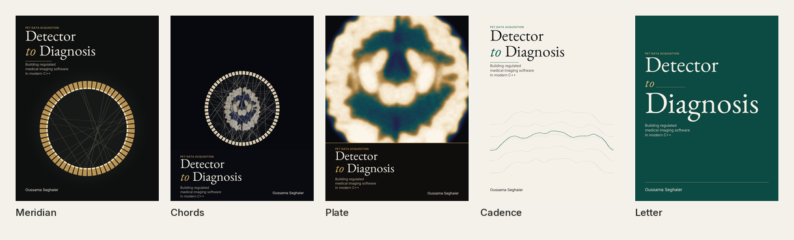
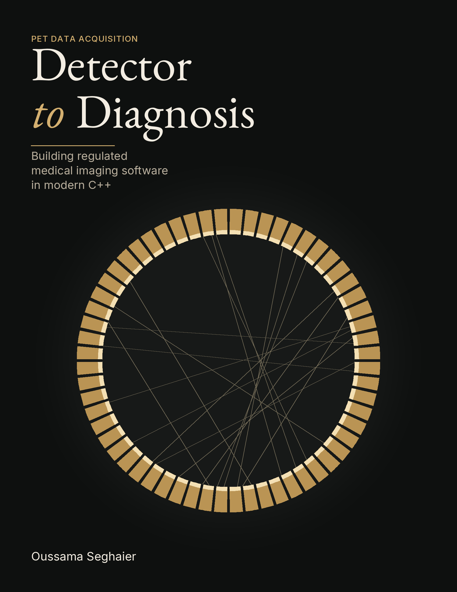
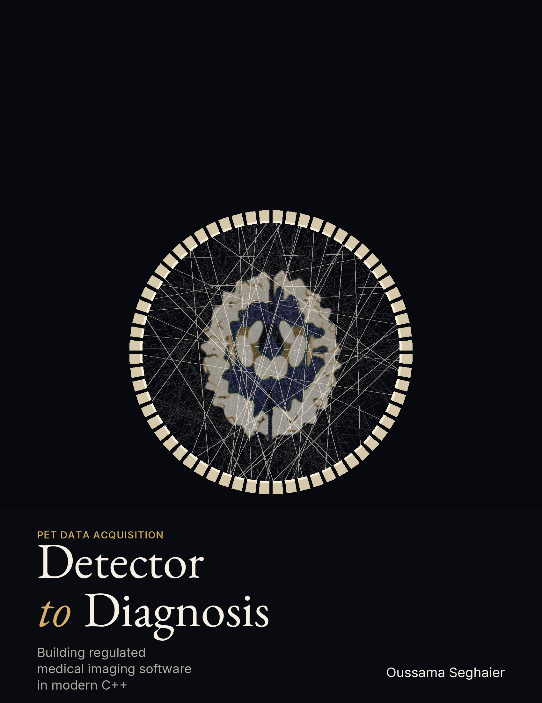
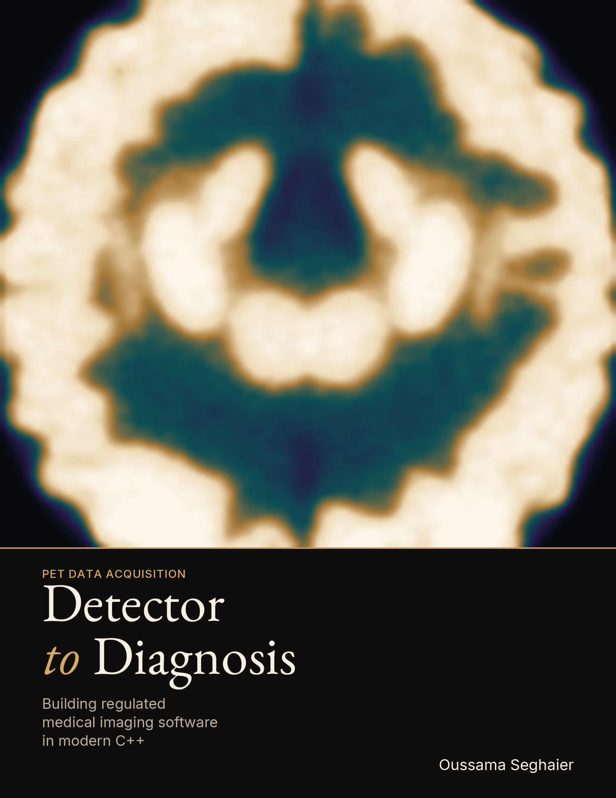
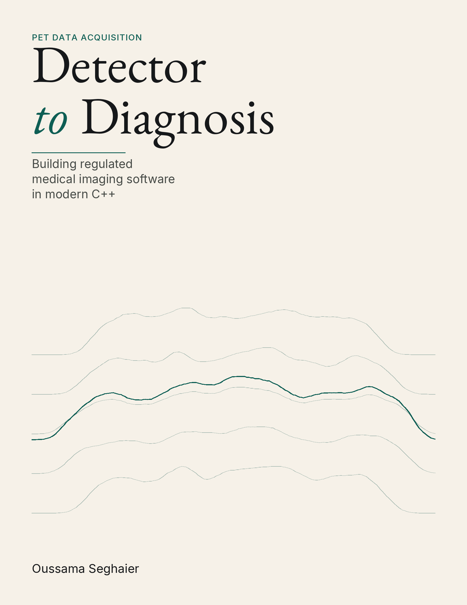
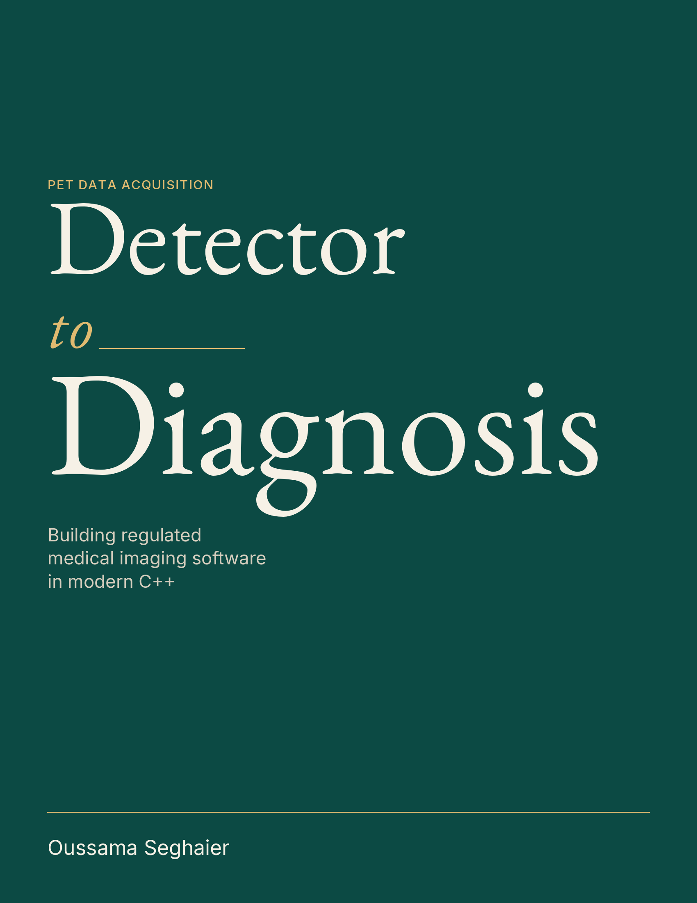

# Cover proposals: five fronts

Proposal only. Nothing here is read by `book/build.sh`, `book/assets/cover.tex`, or
`book/tools/cover_art.py`. The live cover is unchanged.

These are drawn to sit with the Atlas chapter opener (EB Garamond titles, a small
tracked kicker, one rule). Each one uses that type, and then a different picture.
The title is **Detector to Diagnosis**, the subtitle is **Building regulated
medical imaging software in modern C++**, and the author is **Oussama Seghaier**.

The front panel is the 8.5 by 11 inch trim. Type is at least 0.58 inch inside the
edge, inside KDP's 0.375 inch safe zone. The published screen PDF on this main
(commit `340ac27`) is 750 pages with the cover as page 1, so the interior is 749
pages. On white paper the spine is 749 times 0.002252 inch, 1.6867 inch, and the
full wrap is 18.937 by 11.250 inch with 0.125 inch bleed. These files are the
front a reader sees, which is also the Amazon thumbnail. A wrap would extend a
full-bleed image 0.125 inch past the trim.

The scan is the book's own phantom and MLEM reconstruction (`book/tools/cover_art.py`),
recolored and recomposed here. The ring, the chords and the traces are drawn for
these proposals. Fonts are EB Garamond and Inter, both under the SIL Open Font
License. Rebuild with `python3 book/docs/proposals/covers/render.py`.

## Meridian

A brass detector ring on ink, with a few lines of response that meet the crystals.
The title sits above the ring in EB Garamond. Cream `#F3EDE2`, brass `#D4B070`,
ground `#0E100F`.

The ring is large enough to be the thumbnail, and the title is still a title.

## Chords

Coincidence lines through the book's own slice, inside a whole ring, and the type
in a solid band underneath so it survives at a small size. Lines `#FFF4E0` on
`#07090E`, the same brass for the kicker and for "to".

The brain is made of the measurement, not pasted on top of a poster.

## Plate

The reconstruction, edge to edge, in ink, violet, teal and gold instead of the
current rainbow. A gold rule, then the type on an ink band. Image stops from
`#080A0E` through `#241848` and `#0E4E54` to `#ECD690` and `#FCF6EA`. Band `#100E0C`.

One glance is the scan. The band keeps the name readable.

## Cadence

Five real projection angles, drawn as signals on warm paper. One of them is the
voice, in the Atlas teal. Paper `#F6F1E8`, ink `#16181A`, teal `#0E5E54`.

It is the only cover that is quiet, and the trace is still recognizable when the
cover is the size of a postage stamp.

## Letter

No picture. The title is set as large as the measure allows, "to" in italic gold
with the short rule from the chapter opener, on the deep teal of that opener.
Field `#0C4A44`, type `#F6F1E6`, gold `#E0BA70`.

On a white Amazon page this is a block of color with the name in it.

## Recommendation

**Plate.** It is the scan, which is the book, and the band is the Atlas type, so
the thumbnail is a brain and a title at once. Meridian is the one to choose if
the reconstruction feels too soft and the object of the book should be the ring.
Letter is the one to choose if the shelf matters more than the picture.
