# Three directions for the book's look

This is a proposal. It does not change the live interior, the EPUB, the covers, the download page, or MiniDAQ. The pages below were rendered with the book's own tools (Pandoc, XeLaTeX, `boxes.lua`, and the highlight theme) behind `book/docs/proposals/render.py`, which `book/build.sh` does not call. Rebuild with:

```sh
python3 book/docs/proposals/render.py
```

The sample text is a short original passage in the book's voice, so the three directions can be compared on the same words. It is not a chapter.

The critique uses the screen PDF published for version 1.1.1-dev (commit `340ac27`, 10 Nov 2026): 750 pages, 8.5 by 11 inches. Printed page numbers are the folio in the margin. The cover is file page 1 and is not numbered. Part openers use an empty page style, so they have no folio. The Part I opener is file page 22, and the next page is printed page 2.

## The choice

| | Folio | Atlas | Gantry |
|---|---|---|---|
| Idea | A press book for a long technical read | An editorial monograph built around the scan | The service manual of the instrument the book describes |
| Text | Linux Libertine, 10 pt | EB Garamond, 11 pt | IBM Plex Sans, 10 pt |
| Furniture | Libertine small caps | Inter | IBM Plex Sans Condensed and Plex Mono |
| Code | Linux Libertine Mono | JetBrains Mono | IBM Plex Mono |
| Accent | Oxide `#8E3B2F` (7.5:1 on white) | Teal `#0E5E54` (7.6:1 on white, 5.9:1 on sand) | Panel `#1B2430`, amber `#F0B429` on it (8.4:1), amber text `#8A5A00` on white (5.9:1) |

All three faces are free and embeddable (SIL Open Font License, or the GPL with a font exception for Linux Libertine). XeLaTeX loads them with fontspec. The EPUB should embed the same files. Today the PDF is Pagella and Heros, and the EPUB is Georgia and Helvetica, so the two editions are not the same book.

**Recommendation: Gantry.** The cover, the chapter opener, the listing, the table, and the download page are one object, and that object is the scanner. Code is a large part of this book, and Gantry is the only direction whose listing looks like it belongs there: a channel label, a file name, line numbers, and a header row that reads as a measurement. It is also the safest of the three against KDP's 828-page ceiling, and its rules are thick enough for the Boox color layer. Folio is the alternative if a sample chapter set in sans feels tiring. It is the better long read. Atlas is the best use of the existing scan artwork, and it spends the most pages on display type.

## What is weak now

The illustrated interior is a real system: one palette, a part color, emblems, call-out kinds, and figures that survive gray print. The weakness is that the system is louder than the text, and the cover and the download page are not in it.


The cover is the strongest picture in the project. The ring and the reconstruction are a real simulation, not a stock graphic. The type fights that picture. TeX Gyre Heros at display size, the word "to" in cyan, a cyan-to-pink rule, and a detector ring in a full rainbow sit on a violet field. The interior's teal (`#0F766E`) does not appear. A reader who opens the PDF meets a different product on page 1 than on printed page 3.

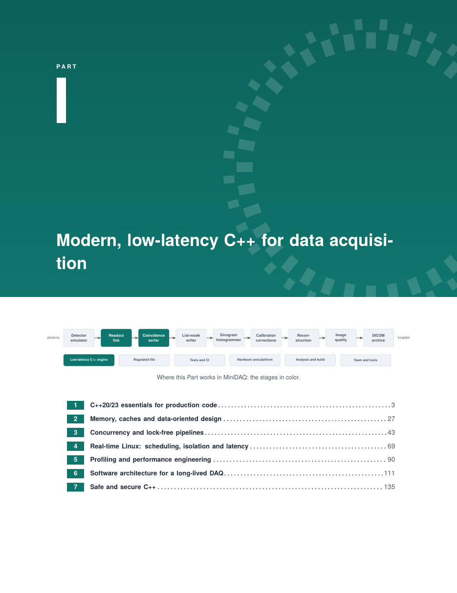

The Part I opener (file page 22) puts the title in a color field and then repeats the pipeline underneath. The copy inside the color field is too small to read, and the Part I title hyphenates "acquisition" there. The lower map is the same drawing again, with labels that wrap ("Recon-struction", "Coincidence" broken over two lines). Five chapter rows sit under it, and the rest of the page is empty. The book already has a long contents list. A part opener that is a second contents list plus an illegible map does not earn its page. Part III (file page 286, the page before printed page 267) is the same template in rose, with the same double map.

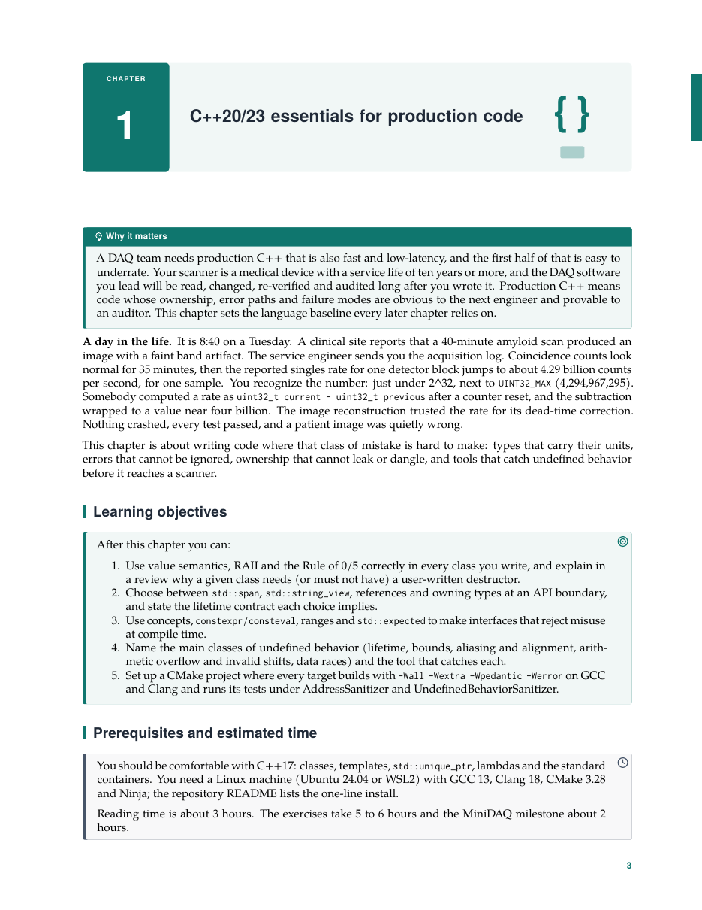

Printed page 3 is the chapter opener. The badge, the "Why it matters" bar, the objectives card, and the prerequisites card are four blocks of the same teal. Part I's color and the "why" color are the same hex (`#0F766E`), so on the first chapter the part system and the call-out system cannot be told apart. The same collision happens elsewhere: Part VIII's gold is the milestone gold, Part IV's blue is the check color, Part VII's green is the exercise color. The chapter 1 emblem is a 40 pt pair of braces and a gray bar. It reads as a token left over from a failed macro, not as a drawing of the chapter. The day-in-the-life paragraph, which is the best prose on the page, is the one thing with no visual rank. A line of that paragraph is about 100 to 110 characters. At 10 pt on a 6.65 inch measure (the 8.5 inch page minus the 1.0 and 0.85 inch margins), that is a long walk for the eye, repeated for 750 pages.

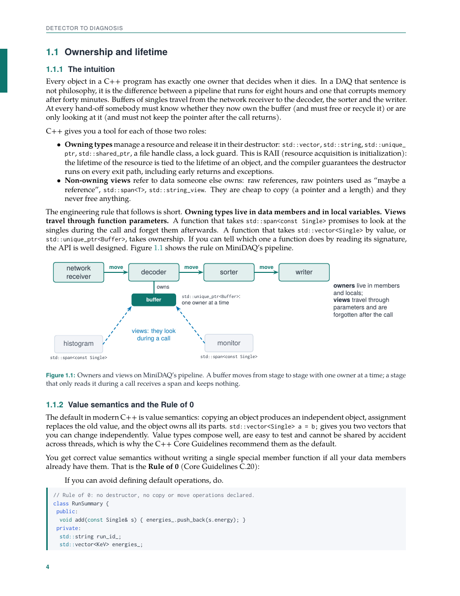

Printed page 4 shows the figure and the listing working, and also where they stay generic. Figure 1.1 is clear, and the caption color is useful. The diagram is cramped: the "views" label sits on the arrows. The listing is a pale gray card with a 2 pt bar and an IDE palette (blue keywords, teal types, purple numbers) and no line numbers and no file name, because it is an inline snippet. A reader cannot say "line 4". The plan asked for line numbers on listings longer than 15 lines. They were not added.

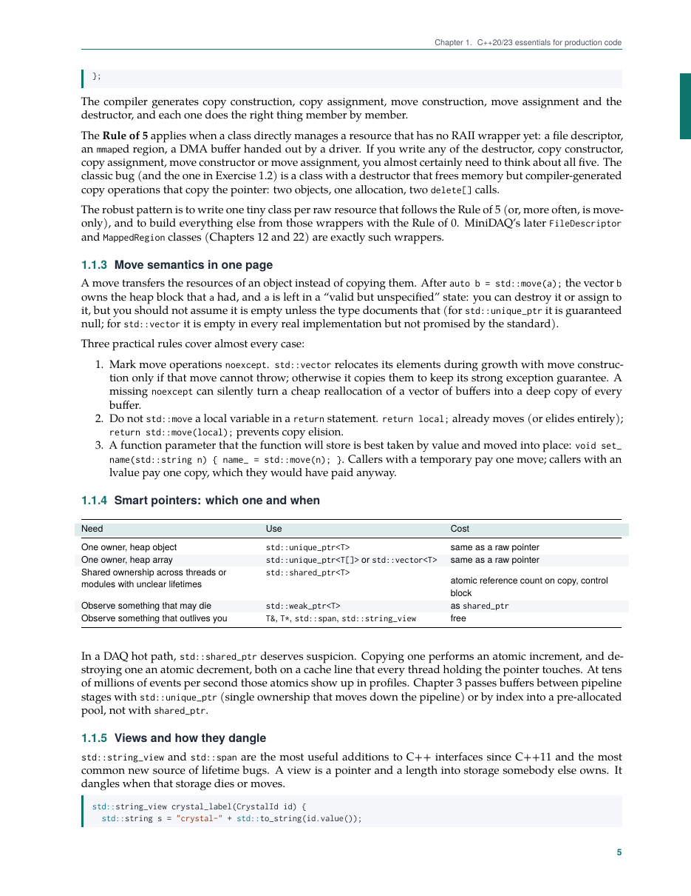

Printed page 5 opens with the closing `};` of that listing, alone, with its bar. A breakable frame that keeps one line is a real defect on a page of code. The table header is a faint tint. The plan asked for white type on the part color. The implementation is `partcolor!14!white`, so the header is barely a header. The whole table, including the body, is forced into the sans at `\small`, so tables drop the text face.

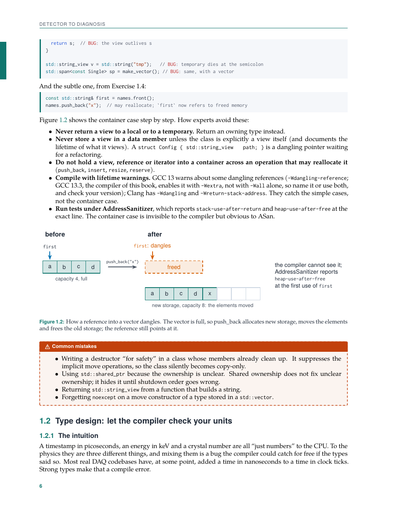

Printed page 6 is the call-out at full volume. The mistakes box is a filled red title bar plus a dashed frame. It is recognizable, and it is the loudest thing on a page whose figure is already doing the teaching. Seven kinds, each with its own hue, icon, and border, plus nine part hues, means a chapter that contains a why, a mistake, a regulated note, and an exercise is four color systems on one spread. The thumb tab at the edge is 0.14 inch wide and carries no part name. On a screen PDF it is a sliver. In the black-ink interior it is omitted, so the edition most likely to be printed loses the only part index.

Printed page 7 is a listing that fills the page (`quantity.hpp`). The file name is a small gray line with a 2 pt tick. There are no line numbers. Keyword, type, string, and comment are four saturated hues. A page of that is an editor theme pasted into the book.

The EPUB does not carry the interior. `templates/epub.css` sets Georgia and Helvetica Neue. Generated rules then paint `h1` through `h4` in the part color, so a section and a subsection are the same hue and the hierarchy flattens. Call-outs lose the TikZ icons. They keep a left border and a tint.

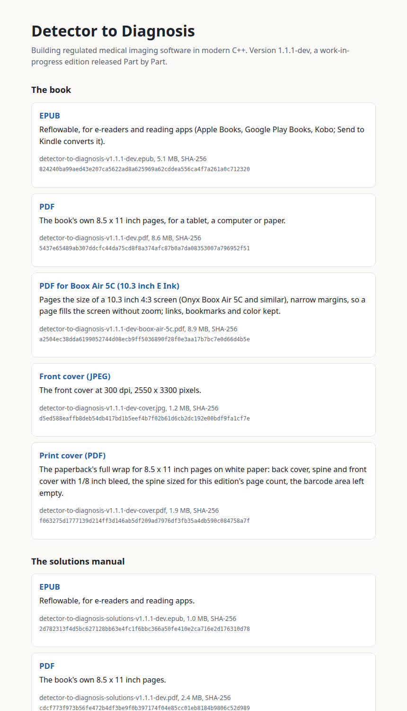

The download page is a correct file list and a different accent (`#1f5fa8`, neither the cover cyan nor the interior teal). There is no cover, no author, and no relationship to the book. The SHA-256 is the heaviest line on every card. "A work-in-progress edition released Part by Part" undersells a 750-page illustrated book. The hashes should stay. They should not be the design.

## Folio

A press interior. One oxide accent, serif for text and headings, small caps for labels, old-style figures, booktabs tables, and a cover drawn as an engraving rather than a poster. Linux Libertine has real small caps and old-style figures. Linux Libertine Mono is one weight, so code uses color and italic instead of bold: keywords in oxide, strings in italic, comments in gray italic.

The measure is 6.2 inches (inner 1.08, outer 1.22) at 10 pt, against 6.65 inches today. That is a shorter line without a new type size. Applied to the whole book it is on the order of a few dozen pages, and the quieter call-outs give some of that back. Do not go narrower than this without counting pages. KDP's ceiling is 828, and the screen PDF is already 750. The 0.4 pt running rule is too thin for the Boox color layer. The boox profile would thicken it to 1 pt, which the palette file already knows how to do.

Chapter opener: a large old-style numeral, the title in the text face, a short oxide rule, and "Part I" in small caps. No badge and no band. "Why it matters" is a label and a hairline, not a filled bar. Objectives and prerequisites are headings, not cards.

Body: indented paragraphs, serif section numbers in oxide, a listing with a small-caps "Listing" label, line numbers, and a warm gray ground. Tables are booktabs with a heavy top rule and no fill. Call-outs share the oxide rule and differ by weight: a thick rule for mistakes, a double rule for the regulated note. The words do the work the colors do today.

Figures: one ink plus oxide. The caption label is small caps. No rounded boxes.

Cover: cream paper (`#F3EEE4`), a Libertine title, and the detector ring as an outline engraving. The rainbow is gone. The scan artwork can stay on the back cover, where the four steps already live.

Download page: the same paper, the same face, the cover as a small plate, and the hash in mono under the title rather than instead of it.

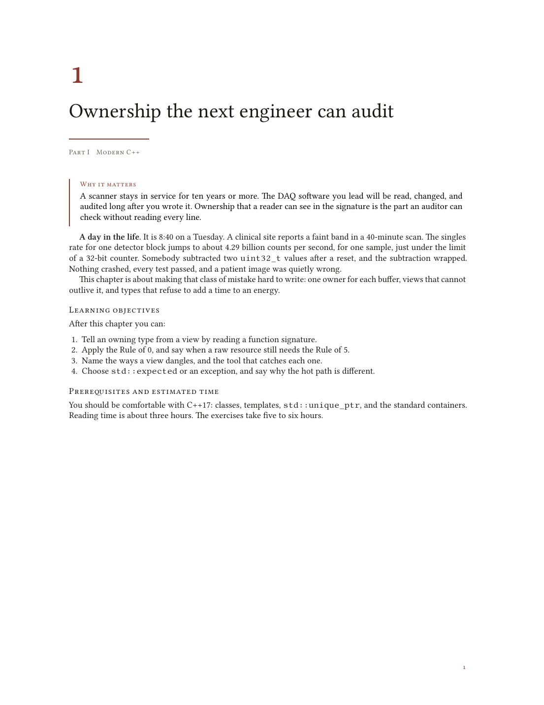

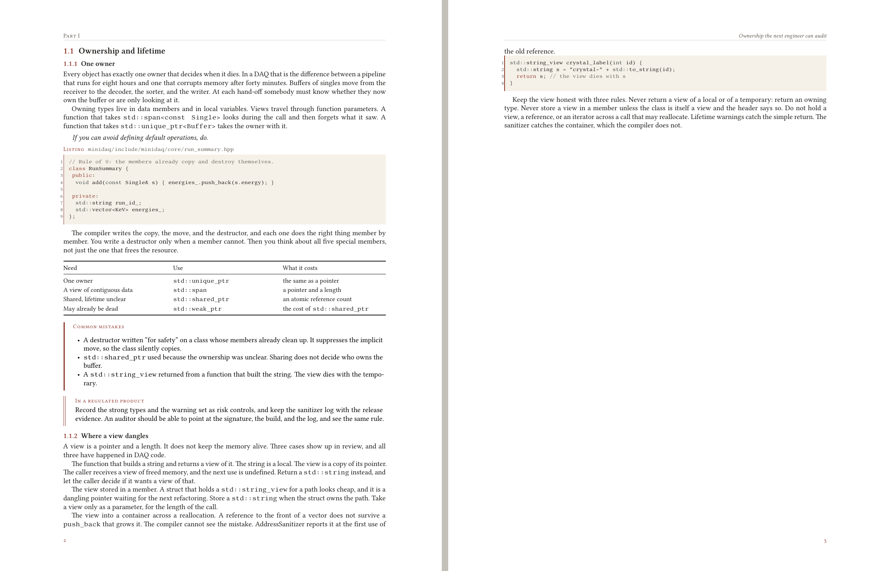

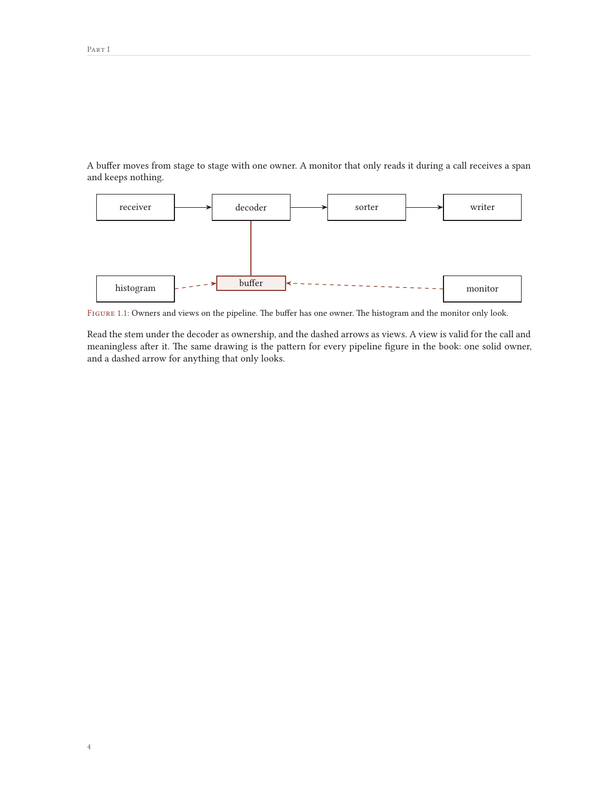


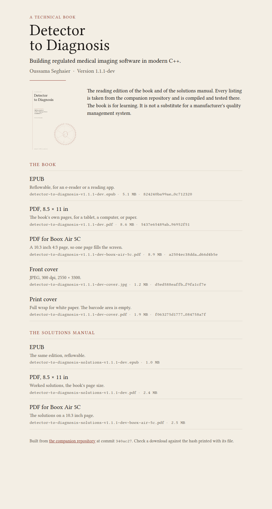

## Atlas

An editorial monograph. EB Garamond for the text and the chapter title, Inter for every label, running head, caption, and table, JetBrains Mono for code. One teal. Sand (`#E7E1D4`) is a surface, not a second accent. Mistakes use a brick red (`#8C3414`, 8.0:1 on white) so a warning is not the part color.

The measure is 6.2 inches at 11 pt, with a wide outer margin and a large page number. Garamond at 11 pt, the 32 pt chapter title, and the air around call-outs will add pages. This is the direction that can push a 750-page book into KDP's ceiling. It is also the one whose thin strokes and pale sand tints fade first on a Kaleido screen. The boox profile would need darker sand and heavier rules, and the display size would need to come down.

Chapter opener: a tracked Inter kicker ("Part I / Chapter 01"), the title in Garamond, a one-line dek, and a 1.4 pt teal rule. The why-box is a sand panel with a 3 pt bar and an Inter label. It does not repeat the chapter color as a filled title.

Body: block paragraphs. Section titles in Garamond, subsection titles in Inter. The listing wears a teal "File" chip and the path in mono, on a warm ground, with line numbers. Tables are Inter, with a sand header and a very light zebra. The quote is an italic with a teal tick, the way a magazine sets a guideline.

Figures: rounded rectangles, teal arrows, a teal caption label in Inter. The figure is a plate, not a diagram crammed against the text.

Cover: white, a Garamond title, and a square crop of the book's own scan as a plate with an Inter caption. The color in the book lives in the picture. The type stays quiet. This is the direction that keeps the simulation artwork on the front.

Download page: the cover is the left half of the screen. Downloads are rows with a teal button. The hash is a mono footnote under the format name.

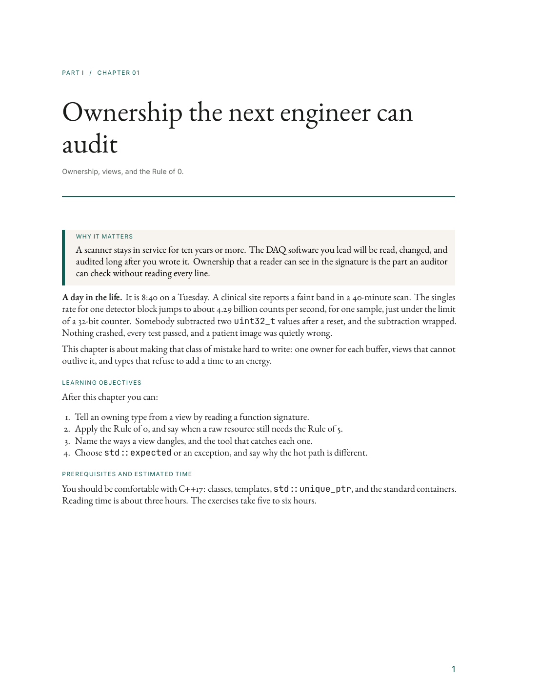

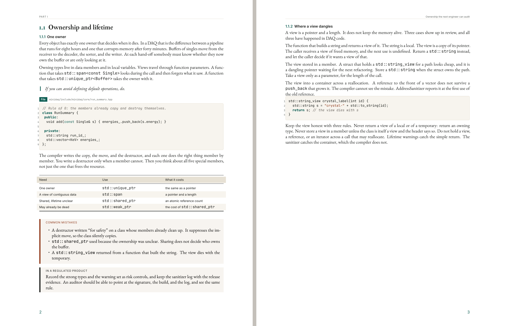

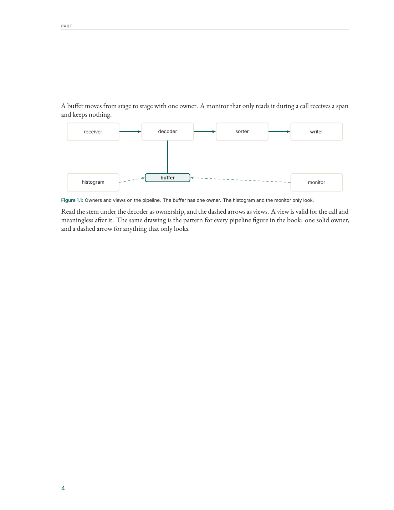


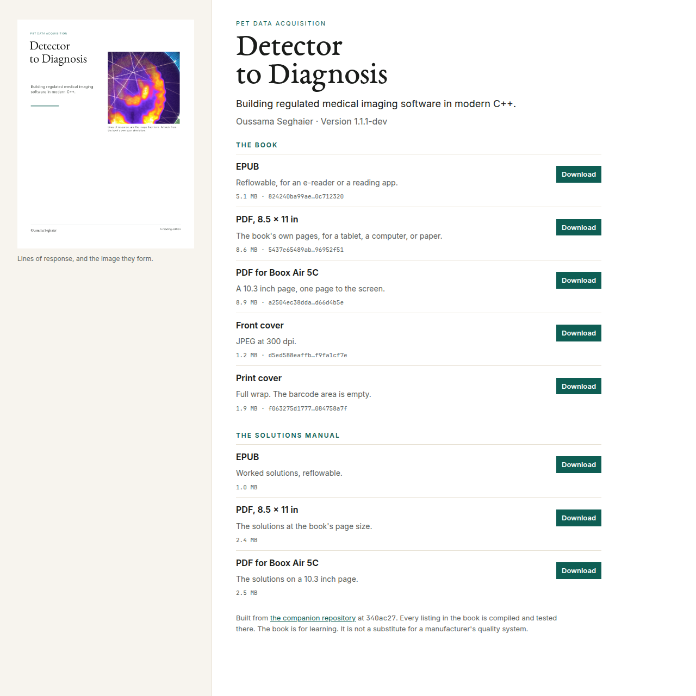

## Gantry

The instrument. IBM Plex Sans for the text, Plex Sans Condensed for the cover and the chapter title, Plex Mono for file names, kickers, line numbers, and the page footer. The page is a sheet: an amber rule at the top, a dark title block for the chapter, and a dark footer on every page (`D2D`, the part, the chapter, the page). Amber on the panel is `#F0B429`. Amber used as text on white is the darker `#8A5A00`, so small type still clears 4.5:1. Signal green (`#1F6B45`, 6.5:1) is only the "note" mark.

The measure is about 7.0 inches at 10 pt sans, wider than today, with less leading wasted on filled title bars. Sans at this size is compact, so this direction is the least likely to threaten 828 pages. The rules are 1.4 pt and 2 pt, which is what the Boox profile already asks for. In gray print the panel becomes a dark gray, the amber becomes a mid gray, and the bracketed labels (`NOTE`, `CHECK`, `RECORD`) keep the meaning.

Chapter opener: a panel. `CH 01  PART I  MODERN C++` in mono amber, the title in condensed white, an amber bar under the panel. Call-outs are a bracket tag plus the book's own title: `[NOTE] Why it matters`, `[CHECK] Common mistakes`, `[RECORD] In a regulated product`. The tag is the channel. The words stay.

Body: block paragraphs in Plex Sans. Section numbers in mono amber. The listing header is a full-width panel, `CH-A` and the file path in amber mono, then the code on a cool gray with line numbers. Keywords are bold ink, types are green, strings are the dark amber. A table header is the same panel with white labels, which is the filled header the plan asked for, used where a filled header means "this is a readout."

Figures: square corners, a black rule, an amber stem for ownership, dashed gray for a view. The caption is Plex, bold label.

Cover: a dark bezel, condensed white title, and the ring as amber ticks on a scale, not a rainbow LUT. `D2D-MAN-001  REV 1.1` is the kicker. The author and `CH 01-37` sit in the bottom margin like a nameplate.

Download page: a release sheet. The hash is a column, the size is a column, and the PDF row carries the amber mark. The hash is still complete, and it is no longer a paragraph under a link.

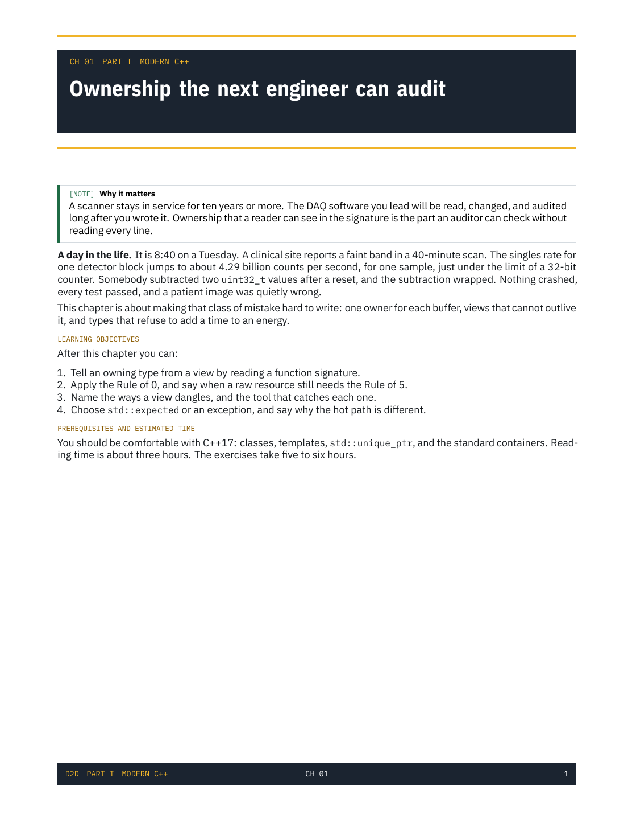

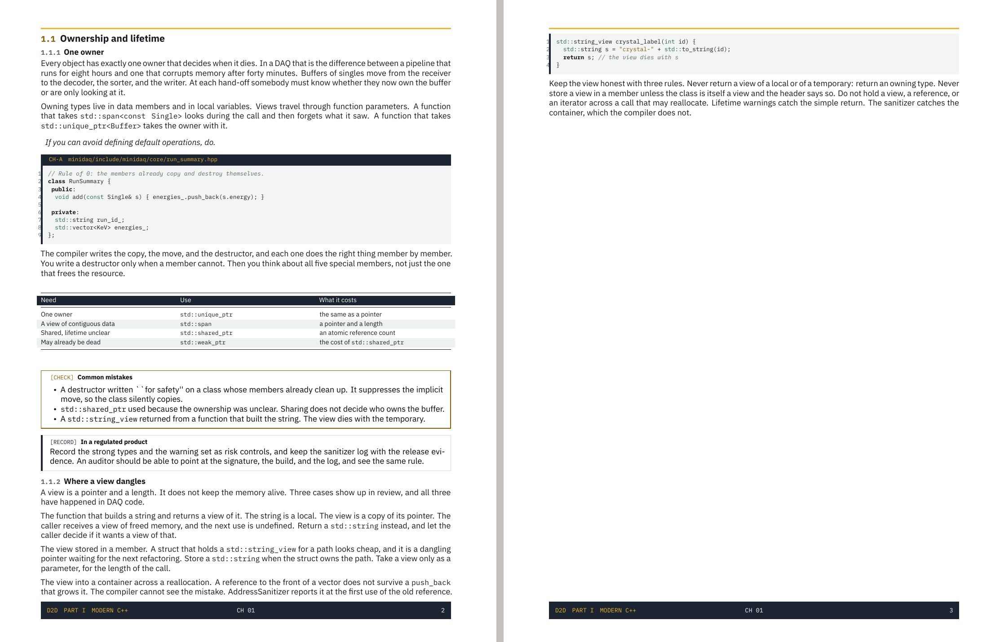

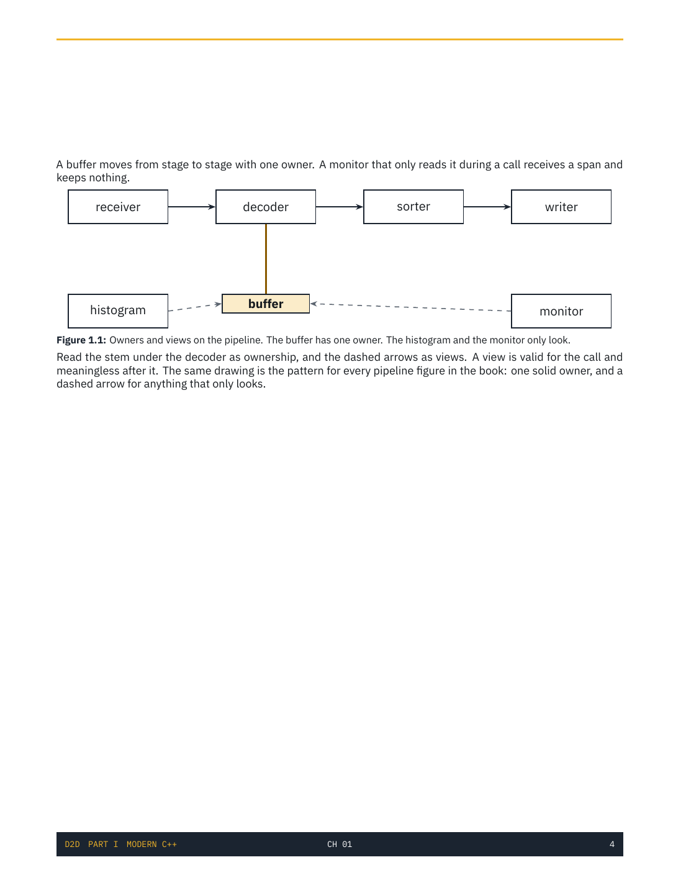


## What stays, whichever direction is chosen

The figure program stays: TikZ and plots from repository data, alt text, a caption, a reference in the text. Color stays decorative. The part number and the call-out label are always printed, so gray print loses nothing. The three profiles in `palette.json` (screen, boox, bw) stay the way a direction meets the medium. `BOOK_INK=bw` stays the KDP default.

Part color should mark the part, and call-out color should mark the kind, and those two sets should not share hex values. Thumb tabs, if they stay, need a part numeral and a width a finger can find. On the Boox they need a 1 pt rule. In the black-ink interior they need a gray equivalent or they should be dropped in favor of the part name in the running head, which all three directions do.

The EPUB should embed the direction's fonts and stop painting every heading level the same color. Icons can stay CSS shapes. They do not need to match the TikZ drawings.

None of this is wired into `book/templates/book-header.tex`, `book/tools/palette.json`, `book/templates/epub.css`, `book/assets/cover.tex`, or `book/tools/site.py`. Choosing a direction is a later change, and it should start by building one chapter both ways and counting the pages.
