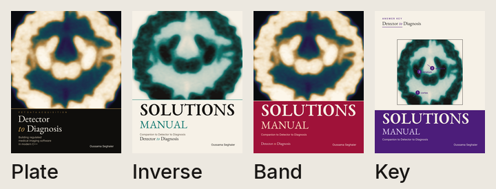
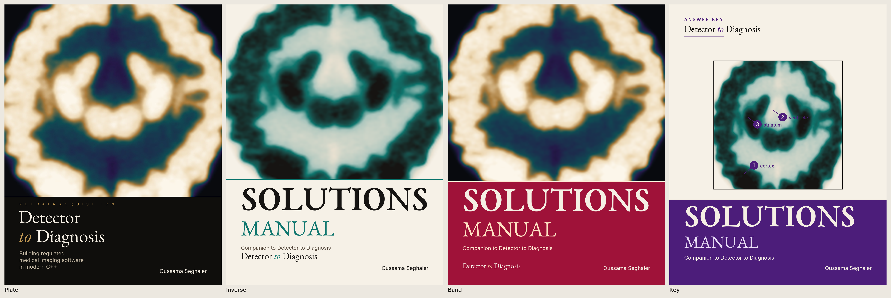
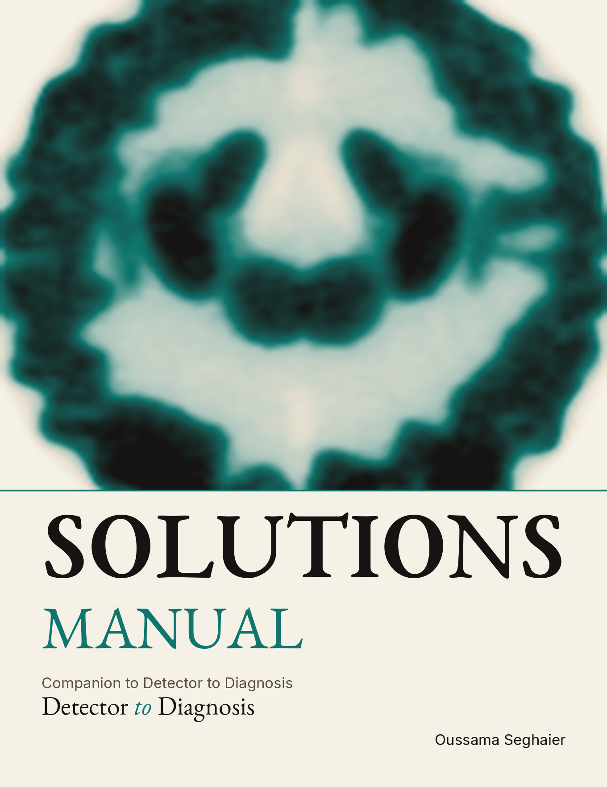
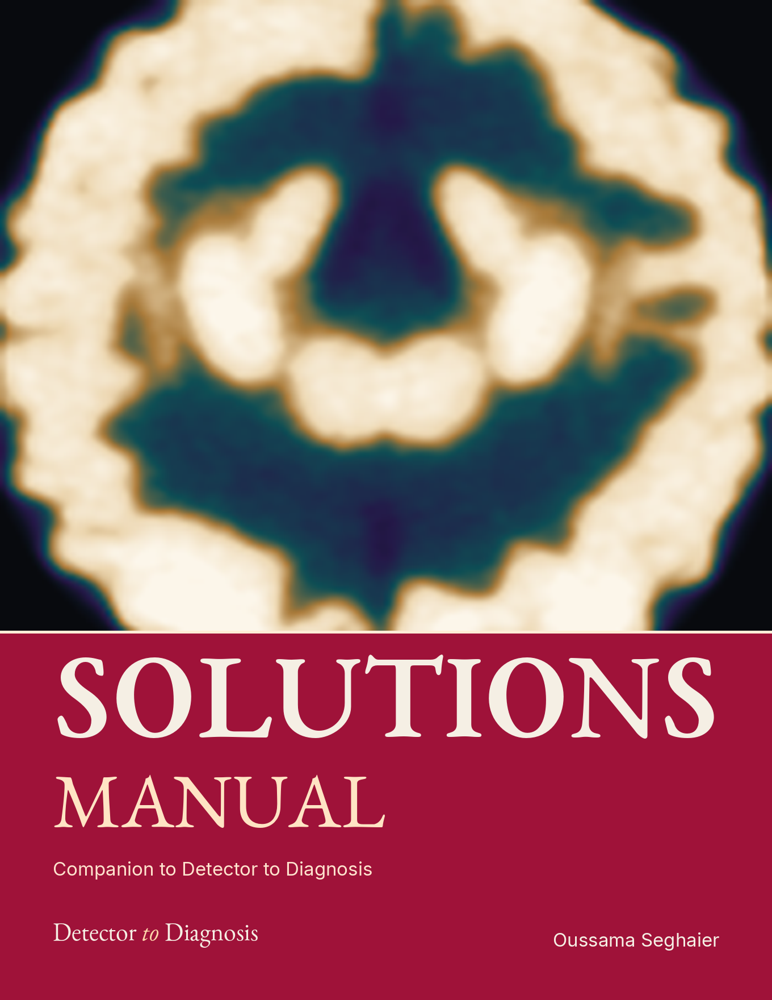
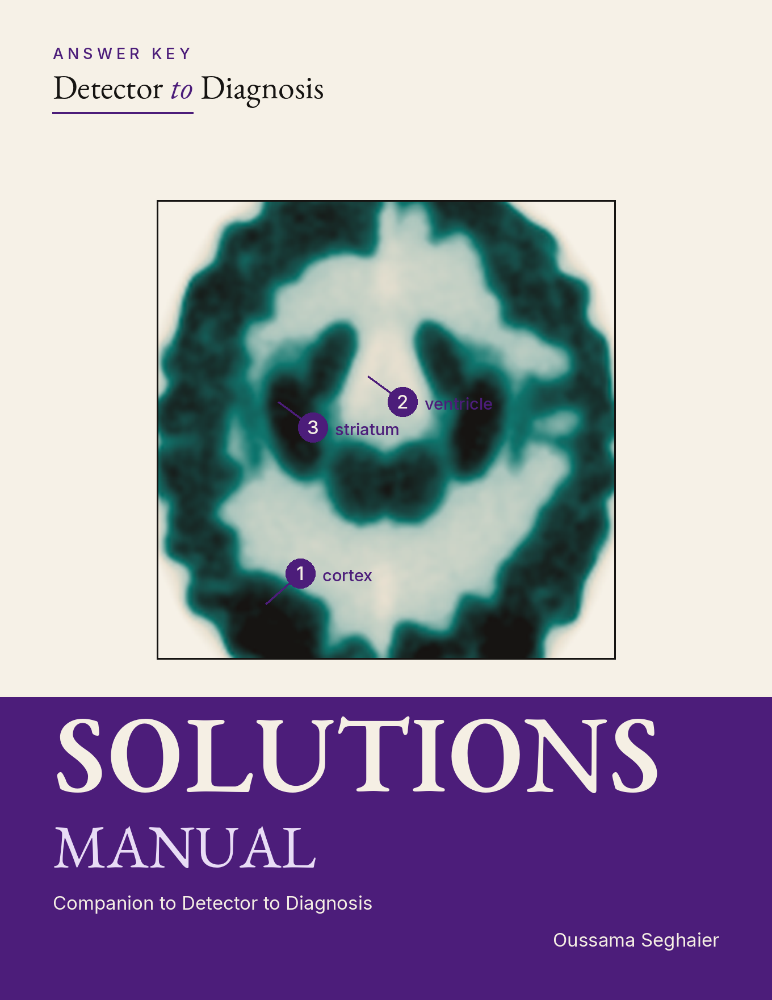

# Solutions cover proposals

The owner chose Inverse. It is the live solutions cover (`book/assets/cover.tex`,
`book/tools/cover_art.py`): the slice printed in teal and ink on paper, with
SOLUTIONS and MANUAL in the paper band. The book stays the Plate cover. Band and
Key stay proposals. Nothing in this folder is read by `book/build.sh`.

These three were drawn so the solutions manual could not be mistaken for the book.
They keep the Plate family (EB Garamond, Inter, the same reconstruction, the series
title, the author) and make **SOLUTIONS MANUAL** the words a thumbnail can read.
Each accent is a color the book already uses. Type sits at least 0.58 in inside
the 8.5 by 11 in trim. Cream on the rose band is 7.0:1, ink on the paper band is
16:1, and cream on the violet footer is 10:1.

`plate.png` is the live book cover, rendered only so the contact sheets can sit
it beside the proposals. Rebuild with
`python3 book/docs/proposals/solutions-covers/render.py`.

## Inverse

The Plate grid on paper. The slice prints in teal and ink, where the book is a
gold photograph on black, and the band is paper instead of ink. **SOLUTIONS** is
ink, **MANUAL** is Part I teal (`#0F766E`).

A light book next to a dark one, from across a room.

## Band

The book's own photograph, with a Part III rose band (`#9F1239`) where the book
has its ink band. **SOLUTIONS MANUAL** is set in cream, with the line *Companion
to Detector to Diagnosis* under it.

Same picture, different object: the rose band is the thing a listing shows.

## Key

An answer key. The slice is a framed figure on paper, marked at the cortex, the
ventricle and the striatum, and the footer is the solutions violet deepened to
`#4C1D7A` (the palette's `#6D28D9` already clears 4.5:1; the deeper one stays
quiet next to the photograph). **SOLUTIONS MANUAL** sits in that footer.

The only one whose picture is a worked figure rather than a full-bleed plate.
