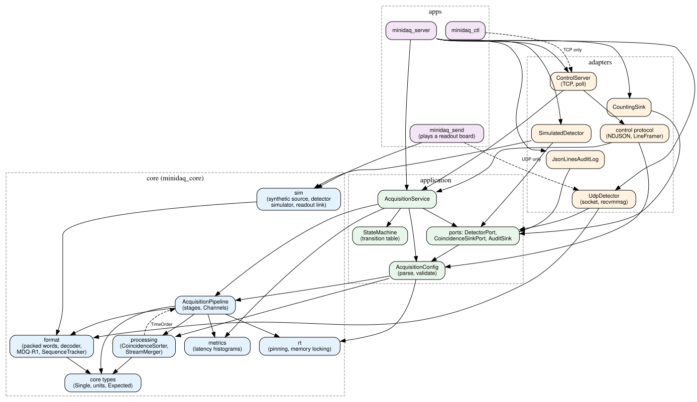
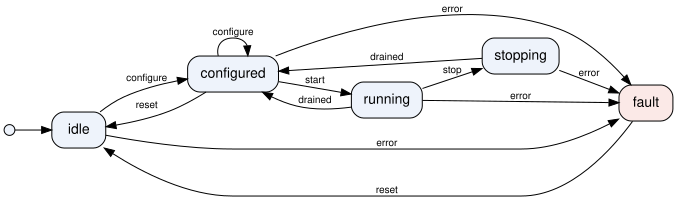

# MiniDAQ software architecture description

Version 7 (MiniDAQ 0.3.0-dev, Chapter 17). Status: draft for review.

This document describes the current architecture of MiniDAQ. It follows the structure that an
architecture description in an IEC 62304 software development process is expected to cover
(software items, their interfaces, SOUP, segregation, verification), written for a teaching
project. It is not a document of the manufacturer's quality management system, and it does not
reproduce the standard: read the standard and your organization's procedures for the actual
requirements. The reasoning behind individual decisions is in the architecture decision records
in [`docs/adr/`](../adr/README.md).

## 1. Purpose and scope

MiniDAQ receives a stream of detector singles, decodes and time-sorts them, pairs them into
coincidences and hands the coincidences to a sink, while an operator configures, starts, stops
and monitors the acquisition over a control API. Version 0.3.0-dev covers:

- the acquisition pipeline (Chapters 2 to 5),
- the control plane: configuration, state machine, service, audit trail and TCP control API
  (Chapter 6),
- a detector simulator with ground truth (Chapter 8),
- a UDP readout link: MDQ-R1 packets, sequence tracking, the UDP detector adapter
  (Chapter 9, [ADR 0009](../adr/0009-udp-readout-link.md)),
- the coincidence sorter in the pair stage and a merger for many boards' streams
  (Chapter 10, [ADR 0010](../adr/0010-coincidence-sorter-and-merger.md)),
- a front-end dead-time and pile-up model in the simulator, and a replay source that drives
  the pipeline with a recorded stream to measure each stage's capacity
  (Chapter 11, [ADR 0011](../adr/0011-front-end-model-and-capacity-measurement.md)),
- list-mode files in the MDQ-L1 format ([specification](../formats/mdq-l1.md)), written by a
  two-thread sink with rotation, an fsync policy, crash-safe renames and a run record, and a
  sinogram histogrammer (Chapter 12, [ADR 0012](../adr/0012-mdq-l1-list-mode-format-and-writer.md)).
- the regulatory file: intended use and regulatory context (Chapter 13), and the IEC 62304
  documents of Chapter 14: [development plan](../regulatory/sdp.md),
  [requirements](../regulatory/srs.md), [trace matrix](../regulatory/trace-matrix.md),
  software items and safety classes (section 4), [SOUP list](../regulatory/soup-list.md) and
  [known anomalies](../regulatory/known-anomalies.md).

Not yet covered: a source that reads several readout links at once (the merger exists, the
pipeline does not use it yet). The control API's security is described in the
[threat model](../regulatory/security/threat-model.md) (Chapter 17).

## 2. Context and external interfaces

| External entity | Interface | Direction | Notes |
|---|---|---|---|
| Detector readout | MDQ-P1 words (`minidaq/format/packed_single.hpp`) through `DetectorPort`: in-process (`SimulatedDetector`) or in MDQ-R1 packets over UDP (`UdpDetector`, `minidaq/format/readout_packet.hpp`) | in | One link per adapter; the readout network must be dedicated (no authentication, [ADR 0009](../adr/0009-udp-readout-link.md)) |
| Data consumer | Batches of `Coincidence` through `CoincidenceSinkPort`: MDQ-L1 list-mode files and a run record (`ListModeSink`, [specification](../formats/mdq-l1.md)), or a counting sink | out | `output.type` selects the sink; files carry no patient identity |
| Operator, scripts, test harness | Control protocol 2.0: newline-delimited JSON over TCP, 127.0.0.1:7700 by default ([ADR 0003](../adr/0003-control-protocol.md)), with token authentication and optional TLS 1.3 ([ADR 0014](../adr/0014-control-api-authentication-and-tls.md)) | in/out | `minidaq_ctl` is the reference client; binding beyond loopback needs TLS and tokens |
| Configuration files | JSON, schema version 1.3 ([schema](acquisition-config.schema.json)) | in | Comments allowed; validated before use |
| Audit trail | JSON Lines file, one record per control action | out | Appended and flushed per record; optional fsync |
| Operating system | Linux: threads, CPU affinity, `SCHED_FIFO`, `mlockall`, sockets | both | Real-time settings from an `rt_profile` (Chapter 4) |

## 3. Requirements that shape the architecture

| Concern | Requirement (book level, not a product requirement) | Where it is met |
|---|---|---|
| Throughput | Sustain 10 M singles/s with margin, 30 M/s at high activity (assumption: confirm with team) | Batched SPSC pipeline, [performance budget](../performance-budget.md); capacity with a realistic stream measured per stage ([ADR 0011](../adr/0011-front-end-model-and-capacity-measurement.md)) |
| Data integrity | No silent loss inside the PC; every drop and every filtered item is counted; no stored record is returned unless its checksum is right | Stage counters; only the source may drop, by policy; the list-mode sink pushes back instead of dropping; CRC-32 per block header and payload ([ADR 0012](../adr/0012-mdq-l1-list-mode-format-and-writer.md)) |
| Durability | A file with a final name is complete; a crash loses at most the unsynced tail of one file | `.part` files, fsync, rename without replace, directory fsync; configurable fsync policy; crash test (`measurements/ch12/crash.txt`) |
| Ordering | Coincidences are never formed from out-of-order singles | Sort stage counts late singles; the service faults the run; the sorter and the merger count and drop singles they cannot place |
| Coincidence rules | Every sorting rule is explicit, configured and tested against ground truth | `CoincidenceSorter` and `SorterConfig` ([ADR 0010](../adr/0010-coincidence-sorter-and-merger.md)), `test_coincidence_sorter.cpp` |
| Latency | Bounded end-to-end latency, measured from when data was due | Per-stage and end-to-end histograms; `max_batch_delay_us` |
| Control | Commands are accepted only in states where they are safe | Table-driven state machine ([ADR 0005](../adr/0005-acquisition-state-machine.md)) |
| Availability of a run | A control client failure does not stop an acquisition | Service owns the run ([ADR 0003](../adr/0003-control-protocol.md)) |
| Accountability | Who did what, when, with what result | Audit trail of commands, transitions, connections and faults |
| Testability | Every hardware dependency can be simulated | Ports and adapters (section 4) |

## 4. Software items and layers

Source: [components.dot](components.dot). MiniDAQ has four layers. A layer may use only the
layers below it; [`layers.json`](layers.json) states the rule and `tools/check_layers.py`
enforces it on every `#include` as part of the unit tests (`architecture.layers`).

| Layer | Items | Responsibility | May use |
|---|---|---|---|
| core (`minidaq_core`) | core types, format, pipeline, metrics, processing, rt, sim | The hot path: decode, sort, pair, count, measure. No JSON, no sockets, no allocation after start | core |
| application (`minidaq_control`) | `AcquisitionService`, `StateMachine`, `AcquisitionConfig`, ports (`DetectorPort`, `CoincidenceSinkPort`, `AuditSink`) | Policy: what an acquisition is, which commands are allowed, how faults end a run | core, application |
| adapters (`minidaq_control`) | `SimulatedDetector`, `UdpDetector`, `CountingSink`, `ListModeSink`, `FileOps`, `JsonLinesAuditLog`, control protocol, `ControlServer`, `TokenStore`, `TlsStream` | Details: where words come from, where results and records go, how commands arrive | core, application, adapters |
| apps | `minidaq_server`, `minidaq_ctl`, `minidaq_jitter`, `minidaq_latency`, `minidaq_sim`, `minidaq_send`, `minidaq_listmode` | Wiring: choose adapters, parse command lines, handle signals | everything |

The application layer depends on interfaces (ports) that it owns; adapters implement them.
This is dependency inversion: the policy does not depend on the details, so the service can be
tested with scripted detectors and fault-injecting sinks, and a real receiver replaces the
simulator without changing the service.

### Software items and safety classes

The layers say what may use what. The software items say what is classified, verified and
changed as a unit. [`software-items.json`](software-items.json) lists every item with the
files it owns, the process it runs in, its IEC 62304 safety class and the hazards it can
contribute to; `tools/check_items.py` (test `architecture.items`) checks that every source
file belongs to exactly one item, that each class is at least what its worst hazard implies,
that items in one process share the highest class there (section 10), and that every
requirement of the [SRS](../regulatory/srs.md) names an item. The hazards are preliminary,
written for this classification; Chapter 15's risk analysis replaces them, and the severities
assume risk controls outside the software (assumption: confirm with team).

| Item | Owns | Runs in | Class | Why |
|---|---|---|---|---|
| core | `core/` | server | B | Types, units, geometry, CRC-32 under every stage |
| format | `format/` | server | B | Decodes readout data, encodes list-mode files |
| pipeline | `pipeline/` | server | B | Moves every single between threads |
| metrics | `metrics/` | server | B | Observes only (A alone); B because nothing segregates it from the pipeline |
| rt | `rt/` | server | B | Scheduling and memory locking of the stages |
| processing | energy filter, sinogram, count rates | server | B | Hot-path filter and quality-control views |
| sorter | `CoincidenceSorter` | server | B | Decides every coincidence |
| merger | `StreamMerger` | server | B | Orders many boards' singles |
| sim | `sim/` | server | B | Test sources linked into the server ([MDQ-PR-009](../regulatory/known-anomalies.md)) |
| config | `config/` | server | B | Validates the acquisition settings |
| service | service, state machine, ports | server | B | Owns the run and its faults |
| protocol | control protocol and server | server | B | Accepts commands from the network |
| access | tokens, roles, start-up token, TLS (`control/access`, `control/tls`) | server, ctl | B | Decides who may control the acquisition |
| readout | UDP detector, default adapters | server | B | Receives the readout link and counts its losses |
| output | list-mode sink, file operations | server | B | Makes the data durable with its run record |
| audit | JSON Lines audit log | server | B | Records actions (A alone); B for the same reason as metrics |
| server | `minidaq_server` | server | B | Wiring and signals |
| ctl | `minidaq_ctl` | its own process | B | Holds an operator token and verifies the server before sending it (A until CR-0004) |
| tools | `minidaq_jitter`, `minidaq_latency`, `minidaq_send`, `minidaq_sim`, `minidaq_listmode` | not shipped | none | Development and verification tools (Chapter 20) |

The software system is class B: its highest item.

## 5. Interfaces between items

| Interface | Provider | Users | Contract |
|---|---|---|---|
| `DetectorPort` | adapters | pipeline source stage (via service) | `read()` fills a span and returns at once (0: no data); `fault()` and `counters()` are thread-safe and read from control threads; `due_times()` optional |
| `CoincidenceSinkPort` | adapters | pipeline write stage, service | `write()` on the writer thread, must not throw; `close(run_record)` once, by the service after the stages have drained, makes the run durable and stores the record (an error is a fault); `fault()` and `counters()` as above |
| `AuditSink` | adapters (file), tests | service, server | Called synchronously on control threads only, never on stage threads |
| `AcquisitionPipeline` | core | service | `start()`, `request_stop()`, `wait()`, `finished()`, counters and histograms readable from any thread |
| `AcquisitionService` | application | protocol, server, tests | `configure`, `start`, `stop`, `reset` return a `CommandResult`; `status()` returns a JSON snapshot; thread-safe |
| `handle_request` | adapters | server | One request line in, one response line out; never throws |
| Configuration | application | apps, protocol | `parse_config` returns a validated `AcquisitionConfig` or all errors with JSON Pointer paths |

## 6. Dynamic behavior

### Threads

| Thread | Count | Created by | Real-time | Work |
|---|---|---|---|---|
| Pipeline stages | 5 | `AcquisitionPipeline::start` | Optional, from `rt_profile` | Source, decode, sort, pair, write |
| Service monitor | 1 | `AcquisitionService` | No | Every 20 ms: port faults, late singles, end of run, latency snapshots |
| List-mode I/O | 1 per run | `ListModeSink` | No | Writes blocks, calls fsync by policy, rotates and renames files, returns buffers to the writer |
| Control server | 1 | `ControlServer::start` | No | `poll()` over up to 8 clients |
| Main | 1 | process | No | Waits for SIGINT/SIGTERM, then shuts down in order |

Control threads take the service's mutex; stage threads never do. The only shared state
between them is atomics (counters, histograms, the stop request).

### Acquisition states

Source: [states.dot](states.dot) and [acquisition-states.json](acquisition-states.json),
which a unit test compares with the transition table in the code.

### A run

1. `configure`: the configuration is validated (and its `rt_profile` read) before the state
   changes; an invalid configuration changes nothing.
2. `start`: the service releases the previous run's pipeline and ports (a port may hold an
   exclusive resource, such as a UDP port), creates fresh ports from the factories, builds a
   pipeline and starts it. A factory failure is a `device_error` and leaves the state at
   configured.
3. The run ends when the source has delivered `stop_after_s` worth of data, or on `stop`
   (state stopping while the stages drain). The monitor sees all stages finished, closes the
   sink with the run record (the final status) and applies `drained`: back to configured,
   ready for another run with the same configuration. A sink that cannot make the run durable
   ends it in a fault instead.
4. A port fault or out-of-order singles: the monitor stops the source and applies `error`. The
   fault stays visible in `status` until a client sends `reset`, which waits for the stages to
   drain.

## 7. Configuration

A configuration file has a `schema_version` (`MAJOR.MINOR`). The reader accepts its own major
version and any minor version up to its own; a newer minor version is refused with a clear
message rather than half-understood. Unknown keys are errors with a "did you mean"
suggestion, so a misspelled key cannot silently fall back to a default. `status` reports the
effective configuration, defaults included, and the audit trail records it at every
`configure`. Schema 1.1 (Chapter 9) adds `source.type` `"udp"` and the `source.udp` section;
`stop_after_s` applies to the synthetic source only. Schema 1.2 (Chapter 10) adds the
`sorter` section: delayed window, window mode, multiples policy, energy window, minimum
sector difference and field of view. Files of 1.0 and 1.1 remain valid and get the sorter's
defaults, which include an energy gate and a delayed window that the earlier placeholder
pair stage did not have. Schema 1.3 (Chapter 12) adds the `output` section: the sink type
(`none` or `listmode`), directory, file prefix and size, fsync policy, block size, buffers and
the maximum block delay.

## 8. Observability

- **Counters** per stage (in, out, dropped, filtered, batches, stalls, idle polls): relaxed
  atomics written by one thread each.
- **Latency histograms** per stage and end to end, cumulative for the run and for the last
  completed interval (`recent_latency_ns`, 1 s by default).
- **Status**: one JSON snapshot with state, run, fault, effective configuration, counters,
  latencies, late singles and the detector's own counters (`detector_counters`: for the UDP
  link, datagrams, packets delivered, lost, reordered and stale, rejections by reason,
  resyncs and the granted receive buffer), and the sorter's eleven counters (`sorter`: singles
  in, rejected by energy and order, windows by size, geometry rejections, prompts, delayed),
  and the sink's counters (`sink_counters`: for list mode, coincidences, blocks, bytes, files,
  buffer waits, fsyncs and their longest duration, dropped blocks after a fault).
- **Run record**: at the end of a run the list-mode sink stores the final status next to the
  data (`<prefix>-<run>.run.json`), so the files say how they were acquired without the logs.
- **Audit trail**: control actions, transitions, faults, client connections. The hot path does
  not log; the monitor thread turns counters and faults into records.

## 9. SOUP

| Item | Version | Used by | Why | Requirements on it |
|---|---|---|---|---|
| nlohmann/json | 3.12.0, SHA-256 pinned | application, adapters, apps (not core) | Configuration and control protocol ([ADR 0004](../adr/0004-json-library.md)) | Correct parsing of untrusted input; errors catchable; not on the hot path |
| OpenSSL | 3.0 or later, the platform's (3.0.13 on the build machine) | adapters (`access`, `tls`), linked privately into `minidaq_control` | TLS 1.3, SHA-256, random tokens ([ADR 0014](../adr/0014-control-api-authentication-and-tls.md)) | Correct TLS 1.3 and certificate verification; a cryptographically secure random generator; security updates from the platform |
| GoogleTest | 1.15.2 | tests only | Unit and exercise tests | Not shipped |
| Google Benchmark | 1.9.1 | benchmarks only | Performance measurements | Not shipped |
| C++ standard library, Linux C library and kernel interfaces | as provided by the platform | everything | Threads, atomics, sockets, real-time scheduling | Platform qualification (Chapter 25) |

The full SOUP list, with requirements on each item and the anomaly review, is
[`docs/regulatory/soup-list.md`](../regulatory/soup-list.md) (Chapter 7); `tools/make_sbom.py` generates the CycloneDX SBOM from the same pins.

## 10. Segregation

- The hot path (`minidaq_core`) has no dependency on the control plane, JSON or sockets;
  `tools/check_layers.py` and the separate library target make this a build-time fact.
- Control clients run in separate processes and reach the service only through the protocol;
  a client crash cannot corrupt the service's memory.
- Within the server process there is no memory isolation between items: a memory error in
  any of them can corrupt any other. MiniDAQ therefore claims no segregation inside the
  process, and every item there has the class of the highest one, B (section 4). Items that
  would be class A alone, such as `metrics` and `audit`, are developed and verified as B.
- `minidaq_ctl` runs in its own process and reaches the server only through the protocol,
  whose input the server validates. Until Chapter 17 this segregation let `ctl` be class A.
  Since CR-0004 it holds an operator token and must verify the server before sending it, so a
  defect in it can disclose a token (HZ-4): process isolation no longer limits what its
  failure can cause, and `ctl` is class B.
- A class C item, if the risk analysis ever finds one, would need either the whole process
  at class C or a segregation that holds against its neighbors' failures, such as a separate
  process with a validated interface. Chapter 15 decides whether any hazard needs it.

## 11. How this architecture is verified

| Check | How | Where |
|---|---|---|
| Layering | Include check on every test run | `tools/check_layers.py`, test `architecture.layers` |
| State machine | Every state/event pair, listener order, concurrency; JSON copy equals code | `test_acquisition_state.cpp` |
| Service behavior | Lifecycle, faults, illegal commands, conservation of counts, with simulated ports | `test_acquisition_service.cpp` |
| Protocol and server | Framing, versioning, errors, disconnects, overlong requests | `test_control_protocol.cpp` |
| Access control and TLS | Tokens, roles, secure defaults, deadlines, TLS 1.3 only, certificate verification, an intruder and an eavesdropper; the protocol fuzzer's authorization property | `test_security.cpp`, `fuzz/fuzz_protocol.cpp` |
| Threat model | Every element analyzed for each STRIDE category; mitigations verified | `tools/check_threats.py`, test `docs.threats` |
| Configuration | Reader rules; schema document agrees with the reader | `test_config.cpp` |
| Coincidence sorter and merger | Exact agreement with the simulator's truth counter, chunking independence, accounting, policies, randoms bias; merger order, waiting, late boards, ties; fuzzing | `test_coincidence_sorter.cpp`, `test_stream_merger.cpp`, `fuzz/fuzz_sorter.cpp` |
| Front-end model and capacity | Dead-time stage against both formulas and by hand, chunking, accounting; replay order and rate; count-rate and bottleneck measurements regenerated by one command each | `test_dead_time.cpp`, `test_count_rates.cpp`, `test_replay_source.cpp`, `measurements/ch11/` |
| Concurrency | All of the above under ThreadSanitizer | `tsan` preset |
| Review | This document and each ADR are reviewed with the code that implements them | pull requests |

## 12. Decisions and open issues

Decisions: [ADR 0001 to 0014](../adr/README.md). Known anomalies, with their evaluation:
[known-anomalies.md](../regulatory/known-anomalies.md).

Open issues:

- Residual security gaps (unsigned list-mode files, an audit trail that its own user can
  rewrite, no rate limiting): [threat model, section 7](../regulatory/security/threat-model.md#7-residual-gaps).
- The monitor polls every 20 ms, so a port fault is noticed up to 20 ms late; if a risk
  analysis needs faster reaction, the stage that sees the fault must stop the pipeline itself.
- Late singles end the run; whether a tolerance is acceptable is a physics and risk question
  for Chapter 15. The sorter itself counts and drops them, so a tolerance could be configured.
- The sorter holds its last 104 ns of singles until more data or the end of the run; a silent
  source needs time markers to flush them earlier.
- The dead-time model's parameters (1 µs per block, worst-case pile-up) are illustrations;
  the NeuroLF front end's measured behavior must replace them before the count-rate curves
  are used for a decision.

## 13. Document history

| Version | Change |
|---|---|
| 1 | First version: layers, ports, control API and state machine (Chapter 6). |
| 2 | UDP readout link (Chapter 9). |
| 3 | Coincidence sorter and merger (Chapter 10). |
| 4 | Front-end model and count-rate capacity (Chapter 11). |
| 5 | Software items with their safety classes, layers and segregation (Chapter 14). |
| 6 | This history (Chapter 16), reconstructed from git for versions 1 to 5. Version 1 was also edited in Chapter 7 (the SOUP list, ADR 0008) and version 4 in Chapter 12 (the list-mode sink, the run record, configuration schema 1.3), each before its release and without a record of the change, which is what this history now provides. |
| 7 | Chapter 17: the control API's security (API 2.0, item `access`, `ctl` class B, OpenSSL as SOUP, CR-0004). Also corrects what version 6 left stale: the API version (1.1 since CR-0003), the nlohmann/json version (3.12.0 since CR-0002) and the range of ADRs. |
