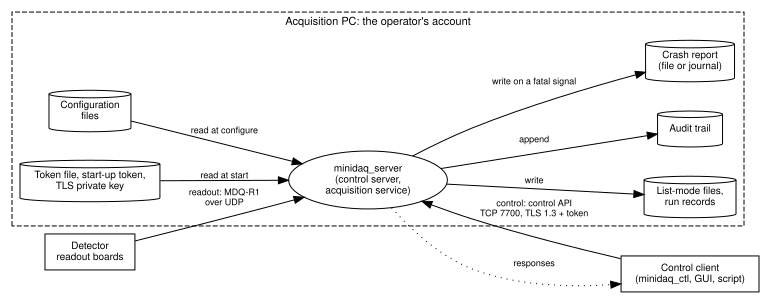

# MiniDAQ threat model

Version 1 (MiniDAQ 0.3.0-dev, Chapter 17). Status: draft for review.

This document records the security analysis of MiniDAQ: what is worth protecting, who could
attack it and how, which threats the software counters and which it leaves to the site, and
how vulnerabilities in MiniDAQ and in its SOUP are found and handled after release. It follows
the activities that IEC 81001-5-1 and the FDA's premarket cybersecurity guidance expect of a
threat model and of vulnerability management, for a teaching project; it is not a document of
The manufacturer's quality management system and does not reproduce either text. In a real product,
the software's threat model is part of the scanner's security risk assessment, and the
environment of section 6 is the scanner's, not an acquisition PC's (assumption: confirm with
team how the NeuroLF's security risk file is organized).

The machine-readable part is [threats.json](threats.json): the elements of the data flow
diagram and one entry per threat. The test `docs.threats` (`tools/check_threats.py`) checks
that every element is analyzed for every STRIDE category that applies to it, that every
mitigated threat names requirements that exist and are verified, and that the risk controls it
names exist in [hazards.json](../risk/hazards.json). It cannot tell whether a threat is missing:
that is the review of section 9.

## 1. Scope and assets

The scope is the software of the [intended-use statement](../intended-use.md): `minidaq_server`,
`minidaq_ctl` and the libraries they are built from, as installed on an acquisition PC that is
connected to the detector's readout boards. The PC's operating system, the detector firmware and
the reconstruction software are outside the scope; section 6 states what MiniDAQ assumes of
them.

| Asset | Why it matters | Property to protect |
|---|---|---|
| A scan in progress | Stopping it, or acquiring it with altered settings, means a repeated scan and its dose, or a quantitation error (hazard H-08). | Integrity of control, availability |
| The acquired data (list-mode files, run records) | Reconstruction and quantitation rely on it. | Integrity; confidentiality is low, since it carries no patient identity |
| The configuration | Decides how coincidences are formed. | Integrity |
| Tokens, the start-up token, the TLS private key | Whoever holds an operator token controls the acquisition. | Confidentiality, integrity |
| The audit trail | Evidence of who did what, for an investigation. | Integrity, availability |

MiniDAQ holds no patient identity or other personal health data (Chapter 12): the link between a
scan and a patient is made by the scanner's software. That keeps most confidentiality threats
small; it does not make the software's security unimportant, because the main risk is to the
scan, not to data.

## 2. Data flow diagram and trust boundaries



The source is [dataflow.dot](dataflow.dot); its node names are the element ids of
`threats.json`, and `tools/check_threats.py` checks that the two agree. The trust boundaries:

- **Control port.** Everything that arrives on the control port is untrusted until the
  connection has authenticated. Before Chapter 17 any process that could reach the port could
  stop a scan; the requirements of section 5 move the boundary from "can connect" to "holds a
  token with the right role".
- **Detector link.** Readout packets are untrusted in form (they are decoded defensively, and
  fuzzed) but trusted in origin: the protocol has no authentication, and the link is assumed
  to be physically controlled (section 6).
- **The operator's account on the acquisition PC.** The server's files (configuration, tokens,
  key, data, audit trail) are protected by the operating system's file permissions. Whoever
  runs as the operator, or as root, is inside the boundary; MiniDAQ cannot defend against them
  and does not try.

## 3. STRIDE analysis

Each element was analyzed for the STRIDE categories that apply to its kind: an external entity
for spoofing and repudiation, a process for all six, a data store for tampering, repudiation,
information disclosure and denial of service, and a data flow for tampering, information
disclosure and denial of service. The table summarizes `threats.json`, which has the full
statements and notes. A status is one of:

- **mitigated:** requirements of the SRS counter the threat, and their tests pass;
- **environment:** the threat is countered by the site, under an assumption of section 6;
- **accepted:** the residual risk is accepted, with the reason in the note;
- **not applicable:** the category has no meaning for this element, with the reason.

| Element | S | T | R | I | D | E |
|---|---|---|---|---|---|---|
| client (external) | T-01, T-02: mitigated | | T-03: mitigated | | | |
| detector (external) | T-04: environment | | T-05: n/a | | | |
| server (process) | T-06: mitigated | T-07: environment | T-08: mitigated | T-09: accepted | T-10, T-11: mitigated | T-12: mitigated |
| control (flow) | | T-13: mitigated | | T-14: mitigated | T-15: environment | |
| readout (flow) | | T-16: environment | | T-17: accepted | T-18: mitigated | |
| config (store) | | T-19: mitigated | T-20: mitigated | T-21: accepted | T-22: mitigated | |
| tokens (store) | | T-23: mitigated | T-24: n/a | T-25: mitigated | T-26: accepted | |
| listmode (store) | | T-27: mitigated | T-28: mitigated | T-29: environment | T-30: mitigated | |
| audit (store) | | T-31: environment | T-32: n/a | T-33: mitigated | T-34: accepted | |

Of the 34 entries, 20 are mitigated, 6 rely on the environment, 5 are accepted and 3 are not
applicable. Three of the mitigated entries are mitigated only in part, and their remainder is a
recorded gap of section 7: T-27 (a CRC detects damage, not a deliberate change), T-06 (on
loopback without TLS) and T-03 (a shared token names a group, not a person).

## 4. Attack tree: stop a running scan

The threat with the highest risk is H-08: someone who is not the operator stops a scan or
changes its settings. The tree lists the ways to reach that goal; an attacker needs one branch
(OR) or every child of a node (AND). The leaf says what blocks it.

```text
Stop or reconfigure a running scan                                OR
├── 1. Send stop or configure on the control API                  AND
│   ├── 1.1 Reach the control port                                OR
│   │   ├── 1.1.1 From a process on the acquisition PC
│   │   │         blocked by: nothing (loopback is always reachable)
│   │   └── 1.1.2 From the network
│   │             blocked by: TLS and tokens beyond loopback (SRS-SEC-005)
│   └── 1.2 Hold an operator token                                OR
│       ├── 1.2.1 Guess one
│       │         blocked by: 256 random bits (SRS-SEC-009); an unknown
│       │         token closes the connection (SRS-SEC-002)
│       ├── 1.2.2 Use an observer token
│       │         blocked by: error forbidden (SRS-SEC-003)
│       ├── 1.2.3 Read it on the network
│       │         blocked by: TLS 1.3 (SRS-SEC-006)
│       ├── 1.2.4 Pose as the server to collect it
│       │         blocked by: certificate check (SRS-SEC-007);
│       │         gap on loopback without TLS (T-06, section 7)
│       ├── 1.2.5 Read the start-up token or a client's token file
│       │         blocked by: mode 0600 in a 0700 directory (SRS-SEC-009);
│       │         open to the operator's account (section 6)
│       ├── 1.2.6 Add a token to the token file
│       │         blocked by: owner-only files (SRS-SEC-008);
│       │         open to the operator's account (section 6)
│       └── 1.2.7 Take it from the audit trail or a log
│                 blocked by: never recorded (SRS-SEC-002)
├── 2. Stop the server process
│         blocked by: the operator's account or root needed (section 6)
├── 3. Make the run fail                                          OR
│   ├── 3.1 Flood the detector port
│   │         detected: losses counted, run incomplete (SRS-RDO-011,
│   │         SRS-CTL-030); the link is closed (section 6)
│   └── 3.2 Fill the disk
│             detected: a write fault the operator sees (SRS-OUT-005);
│             not blocked where other users share the disk (section 7)
└── 4. Keep the operator from controlling the scan                OR
    ├── 4.1 Hold every client slot
    │         blocked by: the authentication deadline (SRS-SEC-004)
    └── 4.2 Flood the control port
              blocked by: the network's rate limit (section 6); the
              acquisition does not depend on the control thread
```

Every branch now ends in a requirement, in an assumption of section 6, or in a detection. Branch
1.1.1 together with 1.2.5 is the residual risk of H-08: an attacker who already runs as the
operator. Branch 3.2 is blocked by nothing: it is detected, and recorded as a gap. Branches
3 and 4 do not make a scan silently wrong; they make it fail visibly, which is the protection of
hazard H-01 against data loss, not a security control.

## 5. Security requirements

The threats that MiniDAQ mitigates itself led to the requirements SRS-SEC-001 to SRS-SEC-009
([SRS, section 2.13](../srs.md#213-security-sec)). They implement the risk controls RC-21 to RC-24
of hazard H-08, and their design is recorded in
[ADR 0014](../../adr/0014-control-api-authentication-and-tls.md). In short:

- **Authentication (SEC-001, SEC-002, SEC-008, SEC-009).** Bearer tokens of 256 random bits,
  sent in an `auth` command; the server keeps only their SHA-256 hashes and compares in
  constant time; an unknown token closes the connection.
- **Authorization (SEC-003).** Two roles. An observer may read the status; an operator may also
  configure, start, stop and reset. A command the server does not know needs the operator role,
  so a command added later is protected until someone decides otherwise.
- **Confidentiality and integrity on the network (SEC-006, SEC-007).** TLS 1.3 only; the client
  verifies the server's certificate and name before it sends a token.
- **Secure defaults (SEC-004, SEC-005).** No tokens means no start, unless authentication is
  turned off explicitly, which is allowed only on loopback; binding beyond loopback needs TLS
  and tokens; a connection that does not authenticate within 10 s is closed. The server makes a
  start-up operator token and writes it where `minidaq_ctl` of the same user finds it, so the
  secure default costs a local user nothing.

## 6. Environment assumptions and accompanying documentation

The risk control RC-25 of H-08 is this section. Its text is written for the accompanying
documentation (the instructions for use and the installation instructions) and is inspected
there before each release. The text below is the book's proposal (assumption: confirm with team
what the NeuroLF's instructions for use say and who approves them).

> **Security of the acquisition PC.** MiniDAQ protects the control of the acquisition against
> other users and against the network. It cannot protect against anyone who uses the operator's
> account on the acquisition PC, or the administrator's account. The site shall:
>
> 1. restrict the operator's account on the acquisition PC to the people who operate the
>    scanner, and protect it with the site's access control;
> 2. not give other users of the PC access to the operator's files, in particular to the token
>    files, to the server's TLS private key and to the directory of the start-up token;
> 3. connect the detector's readout link only to the acquisition PC, point to point or on the
>    scanner's own network, and not to the site's network;
> 4. expose the control port only on the scanner's dedicated network, behind the site's
>    firewall, with TLS and tokens configured; never on a network that the public or the
>    hospital's guests can reach;
> 5. on a PC with more than one user account, configure TLS also on loopback, so that a client
>    sends its token only to the real server;
> 6. give each operator a personal token where the audit trail must identify people, and
>    revoke a token by removing its entry from the token file and restarting the server;
> 7. keep the software and its platform at the versions that the manufacturer releases, and
>    apply security updates that the manufacturer announces.
> 8. keep the acquired data on a file system that other users of the PC cannot fill, such as a
>    partition or a quota of its own.

Threats with the status "environment" in `threats.json` (T-04, T-07, T-15, T-16, T-29, T-31)
rely on one or more of these items; the effectiveness of RC-25 is the inspection that this text
is in the accompanying documentation of the release.

## 7. Residual gaps

These threats are not fully countered. They are recorded so that they are weighed, not
forgotten; each is a candidate for a later change request.

| Gap | Threats | Why it is open | Possible remedy |
|---|---|---|---|
| List-mode files are not signed | T-27 | The CRC-32 of each block detects damage, not a deliberate change with a recomputed CRC. Whoever can write the files runs as the operator (section 6). | A signature or a keyed hash (HMAC) over the run's files, with the key held by the server. |
| The audit trail is not tamper-evident | T-31 | It is appended and flushed per record, but its own user can rewrite it. | Forward records to a log server; or chain the records with a hash, so that a removed or changed record is detectable. |
| No rate limiting of authentication | T-15 | An attacker on the network can try tokens at the rate of new connections. With 256-bit tokens guessing is hopeless; the flood itself is the network's to stop. | A delay after a failed `auth` from the same address. |
| Port squatting on loopback without TLS | T-06 | Another local user who binds the port first receives the start-up token from `minidaq_ctl`. | TLS on loopback (section 6, item 5), or a Unix domain socket whose permissions do the authentication. |
| A disk shared with other users | T-30 | Another local user who fills the disk ends the run with a write fault: the scan fails visibly, but it fails. Section 6, item 8 asks the site to prevent it; nothing in MiniDAQ does. | A partition or quota of its own for the data (section 6, item 8), which the site provides; MiniDAQ could also refuse to start a run without enough free space. |
| Shared tokens | T-03 | The audit trail names the token, not the person, when people share one. | Personal tokens (section 6, item 6), or the site's identity system in front of the server. |

## 8. Vulnerability management

A vulnerability can be in MiniDAQ's own code or in its SOUP. The process:

1. **Know what is shipped.** The SBOM (`tools/make_sbom.py`, CycloneDX 1.5) lists every
   component of a release with its version and package URL, including the platform library
   OpenSSL, which the build takes from the target system (record in the
   [SOUP list](../soup-list.md)).
2. **Scan it.** The CI job `vulnerability-scan` matches the SBOM against public vulnerability
   databases with Grype (a pinned version) on every change to `main` and before each release.
   A scanner reports what the database says about a component's version; it does not know
   whether MiniDAQ uses the affected function.
3. **Triage every finding.** Each finding gets a decision in
   [vulnerability-triage.json](vulnerability-triage.json), in the analysis states of CycloneDX's
   vulnerability exploitability exchange (VEX): `not_affected` with a justification (for
   example, the code is not used), `exploitable` with a plan, `in_triage`, or `resolved`. The
   tool `tools/vuln_triage.py` applies the decisions to a scan report and fails for a finding
   with no decision, or for an `exploitable` finding of high or critical severity without a
   fix date.
4. **Fix or justify.** An exploitable vulnerability is a problem report (MDQ-PR) evaluated like
   any other: for its hazards (Chapter 15), for an update of the SOUP through a change request
   (Chapter 16), and for a field action when the product is in use. A fix is verified by the
   regression test and by a scan that no longer reports it.
5. **Receive reports.** Anyone may report a vulnerability through the channel in `SECURITY.md`;
   the manufacturer acknowledges it, agrees a disclosure date with the reporter (coordinated
   disclosure), and publishes an advisory with the fixed version (assumption: confirm with team
   your company's process and contact for vulnerability reports).

The time limits for these steps belong to the manufacturer's procedure (assumption: confirm with
team). Regulators expect such a plan for post-market vulnerability management: the FDA requires
one, and an SBOM, for a "cyber device" (section 524B of the FD&C Act), and the EU's MDR expects
IT security across the life cycle (Annex I, sections 17.2 and 17.4; guidance in MDCG 2019-16).

## 9. Reviews

| Review | When | By |
|---|---|---|
| Threat model complete for the design | Every change that adds an element, a flow or an interface, in the change's review (change control checklist). | Developer and reviewer of the change |
| Threat model and gaps | Before each release, with the risk file. | Software lead, security expert (assumption: confirm with team who fills this role) |
| Triage of scan findings | When the scan reports a new finding; before each release. | Software lead |
| Penetration test | Before the first clinical release, by someone who did not write the software. | An independent tester |

## 10. Changes

| Version | Change |
|---|---|
| 1 | First version (Chapter 17): STRIDE analysis T-01 to T-34, attack tree for H-08, environment assumptions (RC-25), gaps, vulnerability management. |
